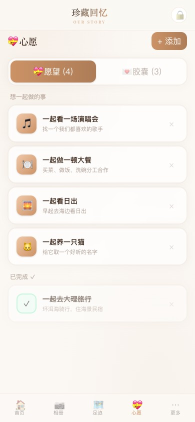
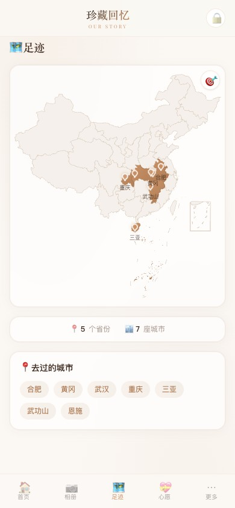
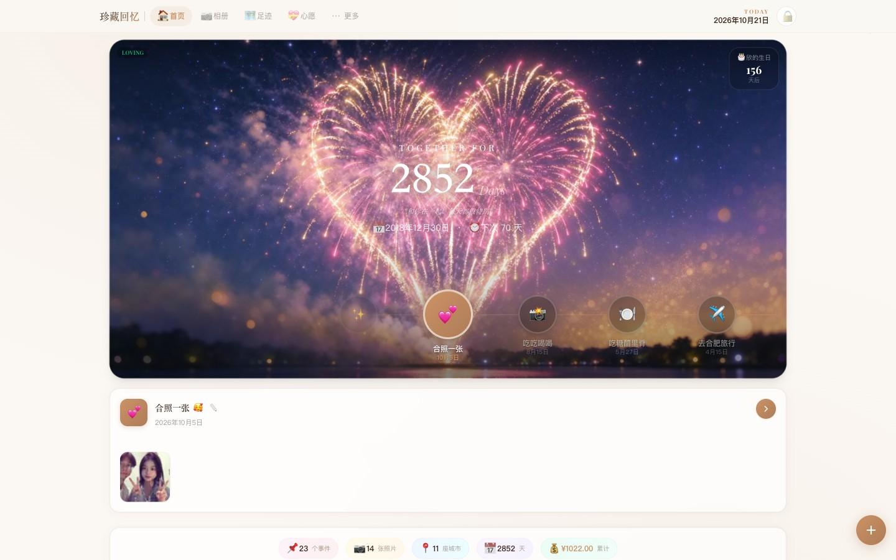

# LoveMemory

情侣纪念站：纪念日、事件时间轴、相册、消费记录、心愿与时光胶囊。

> 开发规范、数据策略、部署方式以 **[AGENTS.md](./AGENTS.md)** 为准，本文件只做概览。

## 界面

<table>
<tr>
<td align="center"><br><sub>首页 · 纪念日时间轴</sub></td>
<td align="center"><br><sub>相册 · 按事件分组</sub></td>
<td align="center"><br><sub>心愿 / 时光胶囊</sub></td>
<td align="center"><br><sub>足迹地图</sub></td>
</tr>
</table>

桌面端封面自动切换横版（16:9），手机端用竖版（4:5）：



## Stack

- Next.js 15（App Router）+ React 18 + TypeScript
- Prisma + **SQLite**
- 图片：阿里云 OSS 可选（未配置自动落盘本地），`sharp` 生成缩略图
- Tailwind CSS v4

## 本地运行

```bash
npm install
npm run dev          # http://localhost:3000
npm test
npm run build
```

## 环境变量

`.env.local`（本地，不入库）：

```bash
DATABASE_URL=file:../data/db.sqlite   # 相对 prisma/schema.prisma 解析 -> <repo>/data/db.sqlite
APP_PIN=******                        # 访问 PIN
APP_SECRET=...                        # 可选但建议：token 签名密钥；更换会使旧登录失效，需重输 PIN

# 以下 OSS 四项可选：不配则上传图片落本地 public/uploads，整站可用
OSS_REGION=oss-cn-wuhan-lr
OSS_BUCKET=lovememory
OSS_ACCESS_KEY_ID=...
OSS_ACCESS_KEY_SECRET=...
OSS_ENDPOINT=https://oss-cn-wuhan-lr.aliyuncs.com

# UPLOAD_DIR=public/uploads           # 可选，本地上传目录
```

## 数据

- 线上：服务器 `/data/app/love-memory/data/data.sqlite`，容器 bind mount，重建不丢。
- 本地：`data/db.sqlite`，内容是从线上拉的一次性快照，**之后不再同步**。
- 本地测试随便改，不影响线上；需要更新的真实数据时手动跑 `./scripts/pull-prod-db.sh`。
- 部署不传数据，只传代码。

## 图片存储

- 默认封面随仓库分发（`public/hero/`，竖 4:5 / 横 16:9 双规格），产品开箱即用，不依赖任何云
- 上传契约：原图进 `photos/`、缩略图进 `thumbs/`；配了 OSS 进桶内同结构，没配落 `public/uploads` 同结构
- 压缩双保险：客户端压到 ≤1.5MB，服务端对 >2MB JPEG/WebP 再兜底；删照片先删文件成功、再删库行
- 完整契约与背景见 AGENTS.md「图片存储契约」

## 部署

手动四步：`typecheck` → `rsync`（排除数据）→ 远程 `docker-compose up -d --build` → 健康检查。
完整命令、服务器事实、IOPS 事故教训见 **[AGENTS.md](./AGENTS.md) 部署章节**。`scripts/deploy.sh` 已删除，不要重建脚本。

线上：<https://lovexin.felixfeng.online>（nginx → 容器 `love-memory`，127.0.0.1:3000）。

## Health check

```bash
curl http://localhost:3000/api/health
# {"success":true,"status":"ok","storageDriver":"sqlite"}
```

## 目录

```text
app/(site)/     页面：首页 album capsule footprint wishes more
app/api/        API Routes
app/lib/        数据层 app-data.ts、prisma.ts、oss.ts、auth.ts
components/     UI 组件
hooks/          数据与 CRUD hooks
prisma/         schema.prisma
public/hero/    默认封面（双规格，随仓库分发）
public/uploads/ 本地上传落盘（gitignore；配了 OSS 则不用）
data/           本地 SQLite（gitignore）
scripts/        pull-prod-db.sh
```
